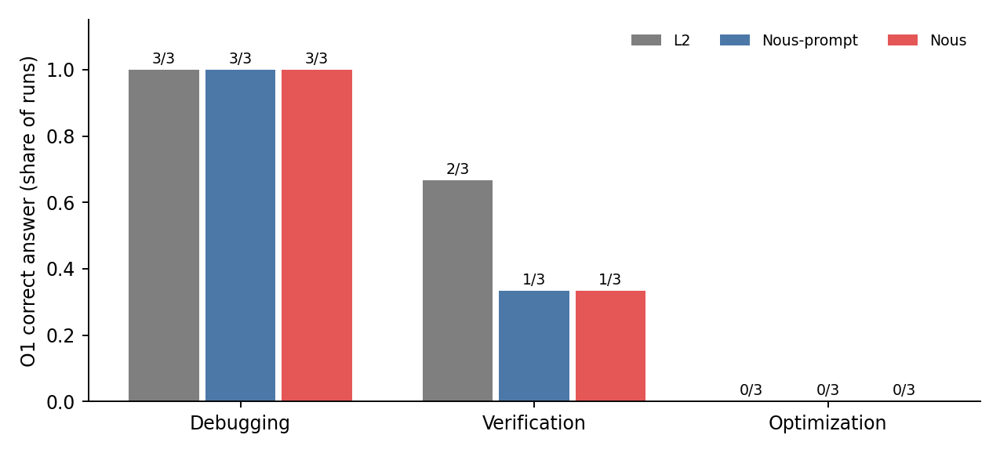
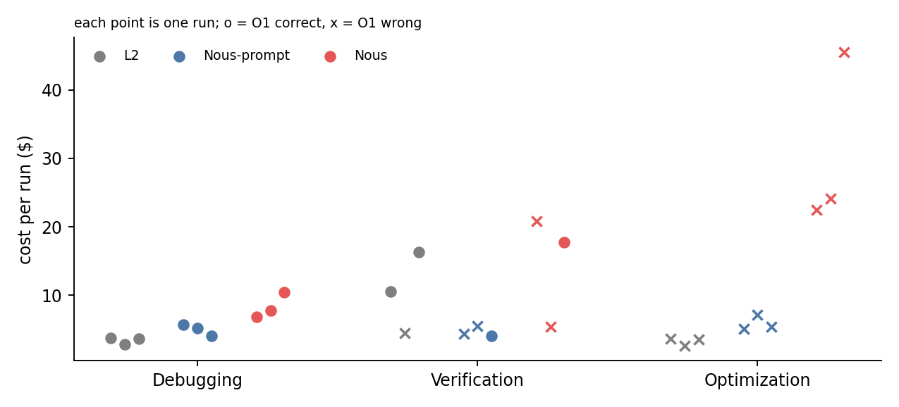
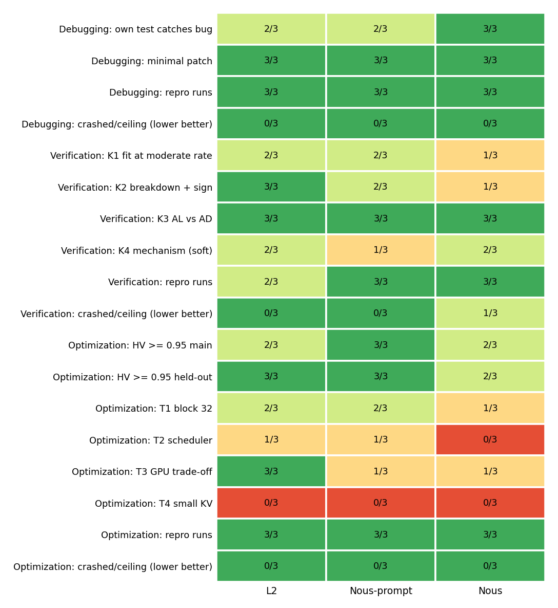

# MLSys controlled study: Nous vs Nous-prompt vs L2, oracle-graded

Run 2026-10-19/20. 27 runs (3 tasks x 3 arms x 3 repeats), every run isolated, scored by a deterministic oracle
(no LLM judge). Raw data: `~/mlsys_runs/runs/<task>/<arm>/rep*/`; full log of every decision and fix:
`PROGRESS.md`; design: `DESIGN.md`.

## Bottom line

Nous did **not** beat the baselines on the primary outcome.

| Task | L2 | Nous-prompt | Nous |
|---|---|---|---|
| Debugging (BLIS bug) | 3/3 correct, $3.40/run | 3/3, $4.99 | 3/3, $8.39 |
| Verification (pd-disagg) | **2/3**, $10.43 | 1/3, $4.67 | 1/3, $14.66 |
| Optimization (blis-search) | 0/3, $3.26 | 0/3, $5.90 | 0/3, $30.69 |

O1 = correct answer, the pre-registered primary outcome. Costs are means over that arm's runs on that task.

- On correctness, the three arms are statistically indistinguishable: 3 runs per cell, and the differences are 0
  or 1 run. Nous was never ahead on O1.
- Nous cost the most on every task: 2.5x L2 on debugging, 1.4x on verification, 9.4x on optimization.
  Total spend for all 27 runs: $259 (L2 $51, Nous-prompt $47, Nous $161).
- Where Nous did differ, it was on secondary, process-level checks (below), not on getting the answer right.

## What each arm is

- **L2**: Claude Code (Opus 4.6), up to N separate sessions; each gets the task, 4 "be scientific" bullets, and the
  previous sessions' answers; stops when it writes `done: true`.
- **Nous-prompt**: same loop, but each session also gets Nous's full methodology prompts (design, execute, report).
  No orchestrator.
- **Nous**: Nous `main` as shipped (Opus 4.6 design, Sonnet 4.6 execute), plus one opt-in change: the continue
  gate follows the agent's own continue/stop recommendation. A short packaging session writes the final answer
  (counted in Nous's cost).

All arms: same task text and output contract, same model family and CLI (2.1.301), same sandbox.

## Tasks and ground truth (all CPU-only on BLIS, built and committed before any run)

- **Debugging**: real BLIS bug `d8271ee` (output tokens double-counted after preemption), reverted, with history
  removed. Agent gets only the user's symptom. Graded by the upstream fix's hidden test, the full suite, and 8
  hidden black-box checks validated against the buggy and fixed builds.
- **Verification**: does the paper's ITL formula hold in BLIS, and where does it break? Key from our own sweep
  (800 BLIS runs): fits within ~1% at rates <= 60; over-predicts at high rate (+14% at 100, +28% at 120); AD has
  lower ITL and higher TTFT than AL. O1 needs all three facts.
- **Optimization**: describe the Pareto structure of a 1800-config space and deliver a search script (<= 200
  evals). The oracle runs the script itself on 3 fresh seeds plus 2 held-out configs and scores the returned
  configs against our exhaustive sweep. O1 = hypervolume >= 0.95 AND >= 3 of 4 structure facts.

## Secondary results

- **Debugging**: all 9 runs fixed the bug (upstream test, suite and hidden checks all pass). Nous's own regression
  test caught the bug in 3/3 runs (L2 2/3, Nous-prompt 2/3). In one run Nous also fixed two related metrics
  (`AllITLs`, `TTFTSum`) that a later upstream commit (`320aa47`) fixed; not scored.
- **Verification**: the common failure for every arm is fitting the formula over the whole rate range, which hides
  the breakdown; or reporting the wrong sign (Nous rep3 said "under-predicts"). Nous rep2 lost 3 of 4 iterations to
  its own schema validator rejecting the executor's `findings.json`; Nous rep4 lost iteration 1 to a Claude Agent SDK
  1 MB message-buffer overflow when the designer read 10 PDF pages in one call.
- **Optimization**: every arm's search script reached hypervolume ~0.995-0.997 on the main and held-out configs
  (except L2 rep4: 0.916). Nous rep4's script also reached 0.995-0.9999, but used 204 evaluations: it runs 4
  "probe" evaluations it explicitly excludes from its own budget count. The oracle counts every real `blis run`,
  so that run exceeds the 200-evaluation limit and scores 0 on hypervolume, as pre-registered. The O1 failures
  are mostly on the structure facts: no arm stated that small KV budgets
  suffice (T4), and most called block size "secondary" although block 32 is on 93.5% of the true front.
- **Stopping**: L2 and Nous-prompt almost always stopped after 1 session (declared done). Nous used 1-4 iterations;
  on debugging its gate said "continue" once after the bug was already fixed.

## Validity checks

- **Isolation** (audited by an independent agent with its own scripts, plus spot checks):
  - Zero tool calls to answer keys, oracle, hidden tests, fixed checkouts, other runs, `~/.claude`, the internet, or
    WebSearch/WebFetch.
  - Each workspace has a 1-commit history with no remote, and none contains `d8271ee`.
  - Sandbox profiles are identical across arms apart from the run path.
  - Readable copies of the fix found in `/tmp` and in one checkout were never touched by any run; they were moved
    to a denied folder mid-study.
- **Cost**:
  - One meter over each run's transcripts (including subagents), with prices that reproduce the CLI's own
    `total_cost_usd` exactly.
  - The independent recomputation matched to 0.00% on every audited run.
  - The CLI agreed on 11/12; on the 12th, the CLI was 0.9% higher (one lost request), so the meter reads low, not
    high.
- **Oracle fixes during the study**: each was a text-matching gap found by reading an answer by hand. Each was
  applied to every arm, every run was rescored after each fix, and each fix is logged in `PROGRESS.md`. The
  pre-registered criteria themselves were not changed.
  - Two fixes changed O1: L2 pd rep2 (false to true) and L2 pd rep4 (false to true).
  - Nous pd rep4 and nous_prompt pd rep4 were scored after the fixes and passed.
  - No fix ever changed a Nous O1 from true to false or the reverse.

## Caveats

- 3 runs per cell; no significance claims. The smallest possible two-sided permutation p-value at 3 vs 3 is 0.1.
- The verification and optimization structure checks match phrases in the final answer. They were fixed before the
  runs, but needed several synonym additions; a reader should spot-check `results.json` against the answers.
- Nous runs as shipped with a Sonnet executor, while the baselines are all-Opus. This was intended to bias against
  Nous; it may explain part of the gap.
- Nous needs `max_buffer_size` raised in the SDK options, and its schema validation rejected otherwise-valid
  iterations. Both are Nous `main` robustness issues; they cost Nous iterations on verification.
- The 200-evaluation limit is strict: Nous search rep4 is scored 0 on hypervolume for 204 evaluations. Its
  structure facts were 1/4, so its O1 would be false regardless.

## What this means for the paper

These tasks have a clear answer, and a strong Claude Code baseline with a short scientific prompt gets that answer
as often as Nous, for less money. This study does not support "Nous gets more correct answers". It supports at most
narrower process claims: Nous's regression tests caught the bug in every debugging run, and it found an extra
related bug once. Even those come from small samples.

Possible next steps (not run):
- harder, longer investigations where a single session runs out;
- fixing the two Nous robustness bugs and re-running the verification task;
- an all-Opus Nous.

## Files

- `figures/`: `fig_o1.png`, `fig_cost.png`, `fig_secondary.png`, per-task grids (`grid_*_runs.png`,
  `grid_*_summary.png`), and `results.json` (every run's scored fields).
- `oracle/`, `harness/`, `keys/`, `tasks/`: everything needed to re-run or re-score.
